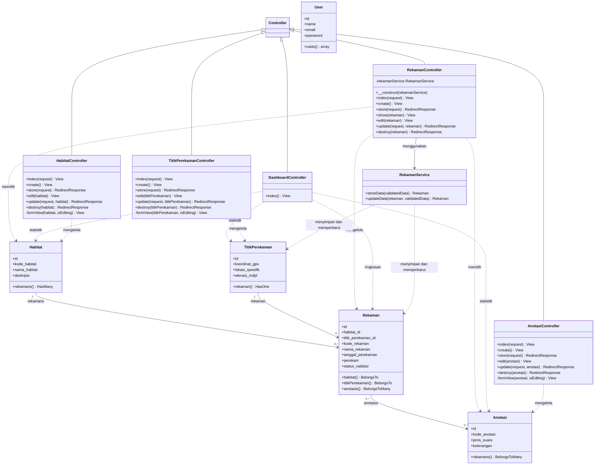

# Class Diagram Sistem Perekaman Suara

Diagram ini merangkum class aplikasi pada layer model, service, dan controller berdasarkan source code proyek.

## Keterangan

- Relasi **Rekaman–Anotasi** direalisasikan melalui tabel pivot `anotasi_rekaman`, yang juga menyimpan `frekuensi_dominan`.
- `RekamanService` menangani penyimpanan dan pembaruan rekaman, detail titik perekaman, dan anotasi dalam transaksi database.
- `User` adalah model autentikasi Laravel dan belum memiliki relasi dengan model domain pada diagram ini.
- `Controller` merupakan base controller aplikasi; tipe seperti `Request`, `View`, dan `RedirectResponse` berasal dari Laravel dan tidak ditampilkan sebagai class aplikasi.
